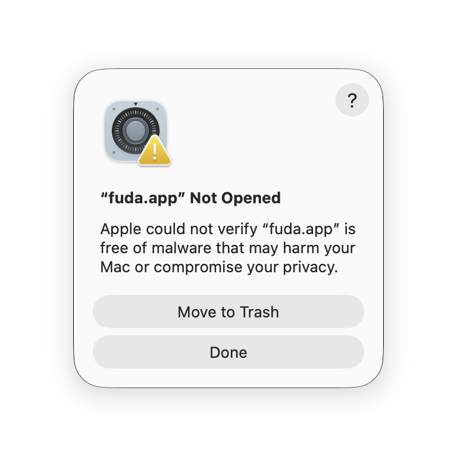
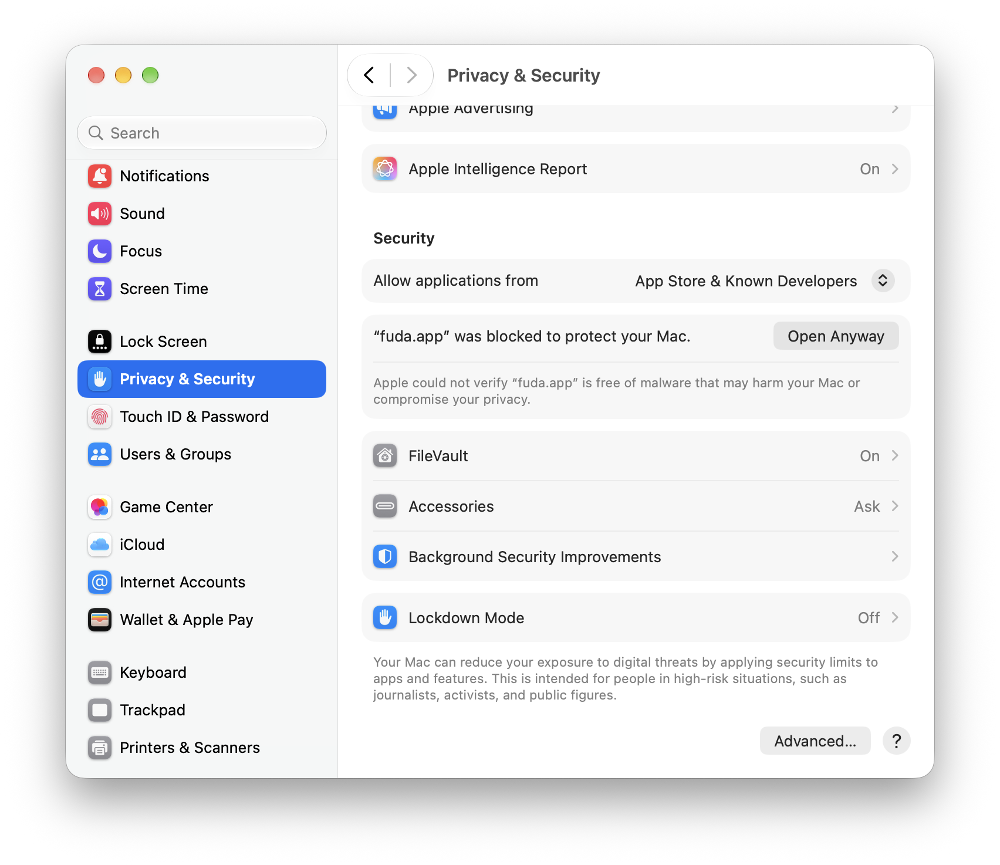
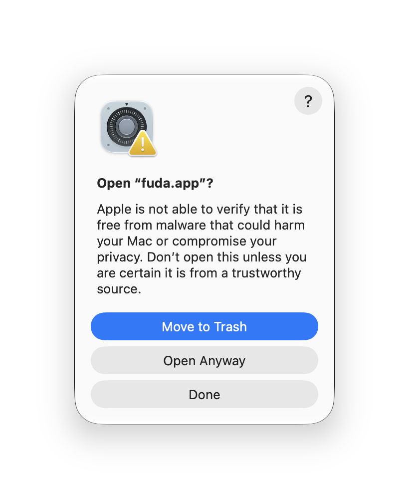

# Install fuda on macOS

fuda is not signed with an Apple developer certificate, so macOS blocks it the first time you open it.
You approve it once in System Settings. After that it opens normally.

## 1. Download

Open the [latest release](../../releases/latest) and download the DMG for your Mac:

- `arm64` for Apple Silicon (M1 and later)
- `amd64` for Intel

Not sure which? Apple menu → About This Mac. "Chip: Apple M…" is Apple Silicon; "Processor: Intel…" is Intel.

## 2. Move fuda to Applications

Open the DMG and drag fuda onto the Applications folder.

## 3. Open it and let macOS refuse

Open fuda from Applications. macOS shows "fuda.app Not Opened". Choose **Done**. Do not choose Move to Trash.



## 4. Allow it in System Settings

Open System Settings → Privacy & Security and scroll down to Security. Next to
"fuda.app was blocked to protect your Mac", choose **Open Anyway**.



## 5. Confirm

macOS asks once more. Choose **Open Anyway**. If it asks for your password or Touch ID, give it.



fuda opens. You will not see these dialogs again.

## If Open Anyway does not show

Run this in Terminal, then open fuda again:

```sh
xattr -dr com.apple.quarantine /Applications/fuda.app
```

## Log in

fuda shows a code and opens GitHub. Type the code there. Azure DevOps works the same way.
